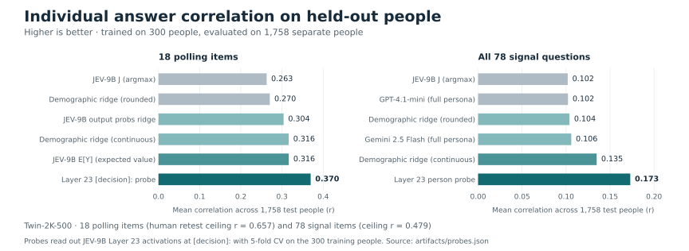

# PopSim

Evaluate synthetic survey respondents against real people, then test how a small human
survey improves their predictions. Built on
[Twin-2K-500](https://huggingface.co/datasets/LLM-Digital-Twin/Twin-2K-500).

## Latest results




<!-- START:highlights -->
- **Pricing:** 17.26 → 8.87 pp RMSE (49% lower than survey alone).
- **Polling:** 0.491 → 0.265 SD RMSE. **A/B:** 0.538 raw → 0.541 calibrated.
- **Individual prediction:** zero-shot `JEV-9B J` matches the demographic baseline (0.102 vs. 0.104 across 78 items).
- **Hidden-state probing:** a Layer 23 ridge probe on `JEV-9B` lifts polling correlation from 0.263 to **0.370** (**0.173** across all 78 items).
<!-- END:highlights -->

These results use one 2,058-person US panel with **existing rich profiles** and a 300-person
calibration split (`1,758` held-out test participants). [Results and limits →](RESULTS.md)

## Background and workflow

In Twin-2K-500, 2,058 US adults answered ~500 questions in Waves 1–3 covering demographics,
personality, values, cognitive tests, and economic preferences. Those answers form each
person's input profile (~24k tokens full, or ~3.2k tokens summarized). Two weeks later, the
same people answered a Wave 4 survey across three tasks:

- **Pricing (40 grocery offers):** buy or pass at a random price from 0 to 2x median.
- **Polling (18 items):** 10 public-policy and 8 technology benefit/risk questions.
- **A/B framing (16 contrasts):** between-subject framing experiments (loss vs. gain, sunk cost, Allais).

PopSim compares published responses (`GPT-4.1-mini`, `GPT-4.1`, `Gemini 2.5 Flash`) and
open-weight [`JEV-9B`](https://huggingface.co/autotrust/JEV-9B) decisions against Wave 4 human
answers along two paths:

| Path | Input signal | 300-person survey | Target | Module |
| --- | --- | --- | --- | --- |
| **Aggregate calibration** | Published twin output answers | Surveyed subset of items | Population buy rates, subgroup polling gaps, and A/B effects on held-out items | `popsim.calibrate` |
| **Hidden-state probing** | `JEV-9B` Layer 23 `[decision]:` activations | 300 training people's Wave 4 answers | Individual answers for the other 1,758 held-out people | `popsim.probes` |

## Try it

Requires Python 3.12+ and [uv](https://docs.astral.sh/uv/getting-started/installation/).

```bash
git clone https://github.com/iamsusiep/popsim.git
cd popsim
uv sync --locked
uv run python -m popsim.demo
uv run pytest
```

After dependency installation, the demo and default tests work offline without credentials
or a GPU. The demo uses one fixed pricing split; the chart averages 500 splits.

[Reproduce the analyses or run JEV-9B →](docs/REPRODUCE.md)

## Sources and license

Built on [Twin-2K-500](https://huggingface.co/datasets/LLM-Digital-Twin/Twin-2K-500),
[Digital-Twin-Simulation](https://github.com/tianyipeng-lab/Digital-Twin-Simulation),
and [JEV-9B](https://huggingface.co/autotrust/JEV-9B).

Code: [Apache-2.0](LICENSE). Derived data: CC-BY-4.0. [Attribution](NOTICE).
