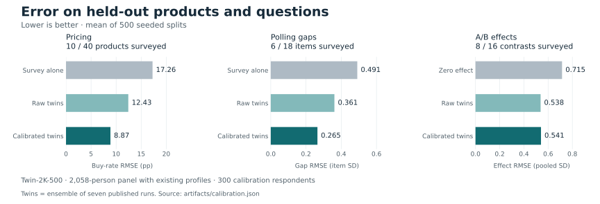
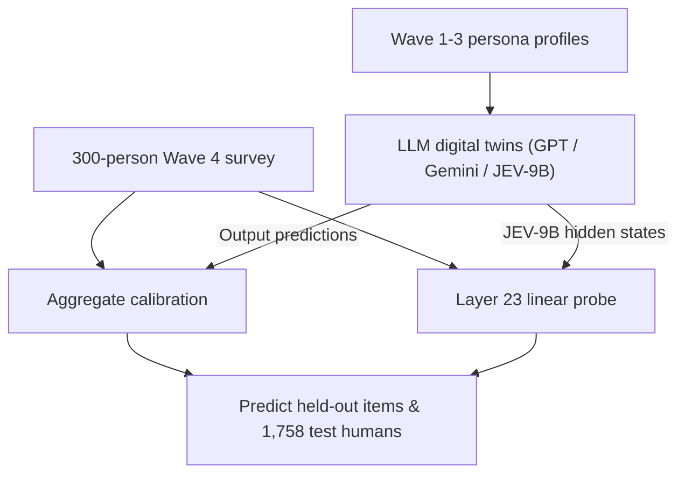

# PopSim

Evaluate LLM "digital twins" against real human survey respondents—and test two ways a small
(`N = 300`) human calibration sample can improve their predictions:
1. **Aggregate calibration (`popsim.calibrate`):** debias population demand curves and subgroup polling gaps.
2. **Hidden-state probing (`popsim.probes`):** read out `JEV-9B`'s internal activations to predict individual people's answers beyond what basic demographics or final LLM outputs capture.

## Background

PopSim is built on the [Twin-2K-500](https://huggingface.co/datasets/LLM-Digital-Twin/Twin-2K-500)
panel of **2,058 US adults**:

- **Wave 1–3 personas (the input):** Every participant first answered ~500 questions covering
  demographics, Big-5 personality, core values, cognitive reflection, and economic preferences.
  Those answers are compiled into each person's **persona profile** (either a ~24k-token full
  transcript or a ~3.2k-token narrative summary).
- **Wave 4 target survey (what models predict):** Two weeks later, the same 2,058 people answered a
  follow-up survey across three tasks:
  - **Pricing (40 grocery offers):** Would they buy a product at a randomly offered price ($0\text{--}2\times$ median)? Scored by demand-curve RMSE in percentage points (`pp`).
  - **Polling (18 opinion items):** 10 public-policy questions (`1–5` support scale) and 8 technology benefit/risk questions (`1–7` scale). Scored by demographic subgroup gap error (`SD`) and individual correlation (`r`).
  - **A/B framing (16 behavioral experiments):** Classic between-subject framing contrasts (loss vs. gain, sunk cost, base rate, Allais). Scored by standardized treatment effect error (Cohen's `d`).
- **Published twins vs. `JEV-9B`:**
  - **Published twins:** Pre-computed Wave 4 responses from the Twin-2K-500 authors using `GPT-4.1-mini`, `GPT-4.1`, and `Gemini 2.5 Flash` prompted with each person's Wave 1–3 persona.
  - **`JEV-9B`:** An open-weights 9B decision model ([`autotrust/JEV-9B`](https://huggingface.co/autotrust/JEV-9B)) that outputs a calibrated probability distribution over answer options (`J` = `argmax` most likely option, `P` = random sample, `E[Y]` = probability-weighted expected value).
- **What we train the probe for:** Zero-shot LLM answers (`JEV-9B J`, `GPT-4.1-mini`) correlate with real individuals at `r ≈ 0.102` across all 78 shared Wave 4 questions—no better than a regression on **7 basic demographic attributes** (`r = 0.104`). To test whether `JEV-9B` internally extracts richer persona traits that its final decision head fails to express, we extract its **Layer 23 hidden state at the `[decision]:` token** and train a regularized linear ridge probe on **300 calibration participants** to predict the remaining **1,758 held-out participants**.

## Latest results



<!-- START:highlights -->
- **Pricing:** 17.26 → 8.87 pp RMSE (49% lower than survey alone).
- **Polling:** 0.491 → 0.265 SD RMSE. **A/B:** 0.538 raw → 0.541 calibrated.
- **Individual prediction & probing:** zero-shot `JEV-9B J` matches the 78-item demographic baseline (0.102 vs. 0.104),
  but on the 18 polling items replacing `argmax` (0.263) with expected value `E[Y]` reaches 0.316 and a
  Layer 23 `[decision]:` linear probe reaches **0.370** (**0.173** across all 78 signal items).
<!-- END:highlights -->

[Detailed tables, probing ablations, PC interpretation, and limits →](RESULTS.md)

## How it works



## Try it

Requires Python 3.12+ and [uv](https://docs.astral.sh/uv/getting-started/installation/).

```bash
git clone https://github.com/iamsusiep/popsim.git
cd popsim
uv sync --locked
uv run python -m popsim.demo
uv run pytest
```

After dependency installation, the demo and default tests work offline without credentials
or a GPU. The demo uses one fixed pricing split; the chart averages 500 splits.

[Reproduce the analyses or run JEV-9B →](docs/REPRODUCE.md)

## Sources and license

Built on [Twin-2K-500](https://huggingface.co/datasets/LLM-Digital-Twin/Twin-2K-500),
[Digital-Twin-Simulation](https://github.com/tianyipeng-lab/Digital-Twin-Simulation),
and [JEV-9B](https://huggingface.co/autotrust/JEV-9B).

Code: [Apache-2.0](LICENSE). Derived data: CC-BY-4.0. [Attribution](NOTICE).
